# FOGLINE

A real-time strategy serious game for learning to decide under uncertainty, in hybrid and cognitive warfare. You command a small force through fictional crises on real maps: verify first, then decide before the countdown ends. The truth is only revealed at the debrief.

**Fictional exercise. Prototype in development.** Events, actors and game values are invented. There are no nuclear weapons, no strikes on cities and no real weapon parameters.

**Play in your browser:** https://otakuch.github.io/fogline/ (choose English or Français at the top of the home screen)

[Lire en français](#en-français)

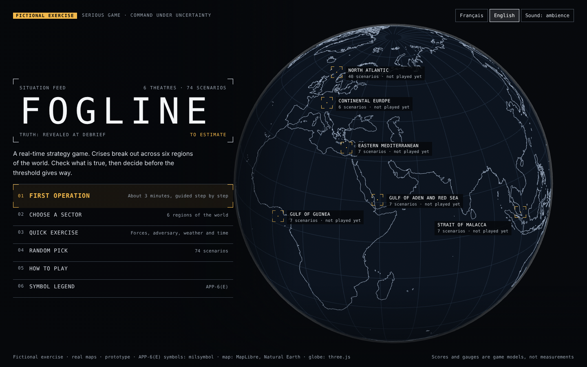

## The game

- **Six theatres:** North Atlantic, continental Europe, Gulf of Guinea, Gulf of Aden and Red Sea, Eastern Mediterranean, Strait of Malacca
- **75 missions and a tutorial**, in English and French: viral videos, cyber intrusions, threatened subsea cables, ships without AIS, jamming, false alarms, and direct action missions with naval raids, salvos, drone swarms and the recapture of seized sites or ships
- **Quick exercise:** compose a mission by choosing force size, adversary behaviour and level, theatre, situation, weather and time of day
- **Fixed order of battle:** each mission starts with US platforms under their real names (P-8A Poseidon, MQ-4C Triton, Arleigh Burke-class destroyer, Freedom-class LCS and others). All values are fictional game values
- **Four domains:** land, sea, air and cyber tabs for your forces. Land units include a SEAL team, a security platoon and a defensive coastal battery
- **Naval play inspired by Jane's Fleet Command:** embarked helicopter, contacts that go from detected to classified to identified, task group formations (ring, forward screen, column, radar picket) and time compression up to ×16
- **Overview and tactical view:** one key for the whole theatre, one to centre and zoom on the selected unit, contact or crisis, with range rings. Orders can be given to a whole domain (land, sea, air) in one click
- **Electronic warfare and cyber:** jam a contact from an equipped unit, which then gives its own position away; blind or slow a contact by cyberattack. A cyberattack can fail, can be spotted, and may then turn into a public crisis that calls for an answer and weighs on public trust. Described by effects only
- **Missile tracks:** every shot in flight is a numbered track with its heading; the icon shows whether it is in flight, uncertain, intercepted, arrived or lost, and the crisis file lists which defence can engage it
- **Three ways to play time:** real time, semi-real time (time stops at every turn and every crisis) or turn-based (you give orders, then "End turn" plays 30 seconds)
- **Relief and 3D view:** an optional relief map of mountains and sea floor, lit by three.js from ETOPO elevations, and a 3D view of the theatre with your units, known contacts and crisis zones
- **Collisions and inertia:** units of the same medium no longer overlap, ships keep off coast corners, and each unit accelerates, brakes and turns according to its type (an LCS is nimbler and faster than a destroyer)
- **Realistic rules (Full level, optional):** military targets only, damage that slows a unit, automatic withdrawal, bingo fuel, radar back on when targeted, own-noise and thermal-layer effects on sonar, reaction delay. Adapted by effect only, with fictional values
- **Submarine hunt:** a convoy escort mission across the Iceland–Scotland gap where some echoes are a submarine and others are not
- **Decision cards:** every option shows its cost, its estimated escalation and why it is unavailable; a high-risk option asks for confirmation
- **Attention as a resource:** every check costs a token. You cannot verify everything
- **Escalation control:** rules of engagement, postures, an escalation threshold and a cognitive centre of gravity (CGC) built on three pillars: epistemic security, social cohesion and institutional resilience
- **Force morale** and coalition cohesion, both counted in the score
- **Two command levels:** Simple (default, advice on request) and Full (diplomacy, posture, manual assessments, fire allocation)
- **No dead time:** when nothing is urgent, one button skips to the next event
- **Two decision clocks:** 90 s on Easy, 30 s on Hard
- **In-game menu:** settings, legend, restart or return to the home screen
- **Debrief:** an explained verdict, the truth of each crisis next to your own assessment, key lessons, losses and a replay on the map

## Screenshots

| | |
|---|---|
|  | 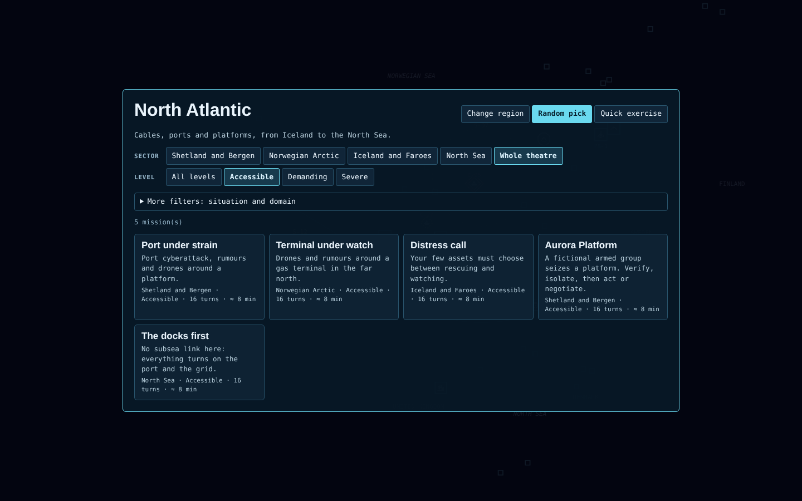 |
| Choice of theatre | Mission catalogue |
| 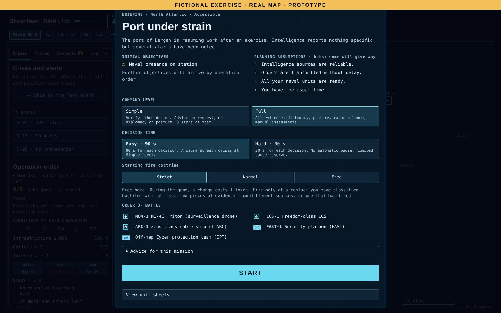 | 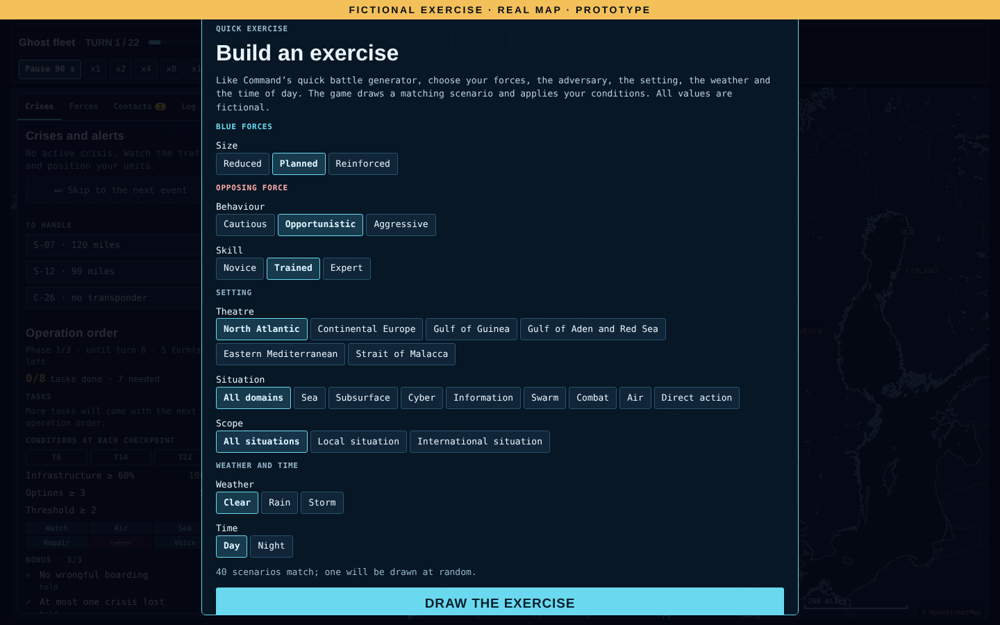 |
| Briefing and order of battle | Quick exercise |
| 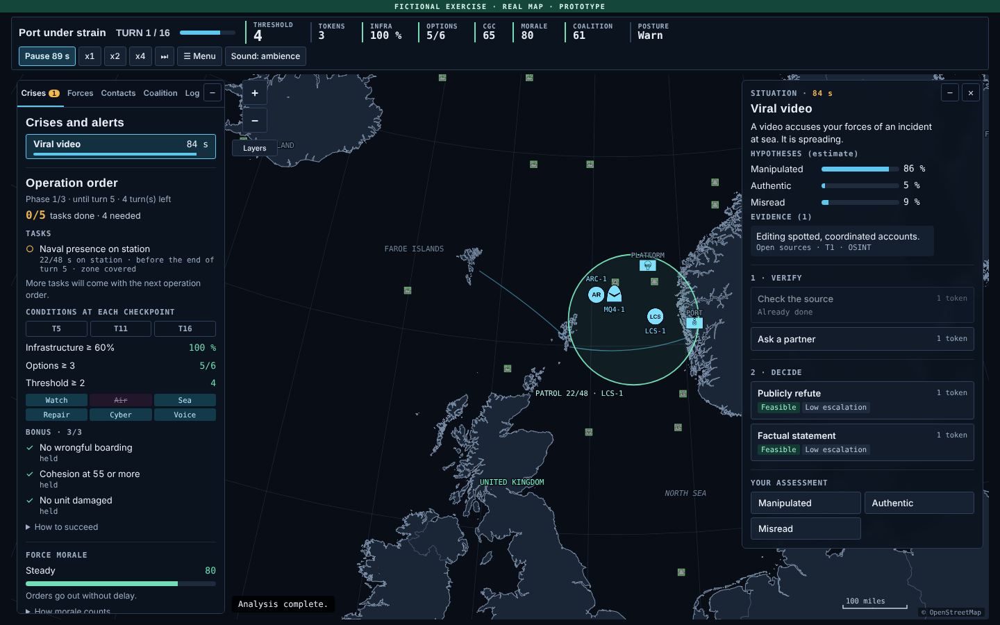 | 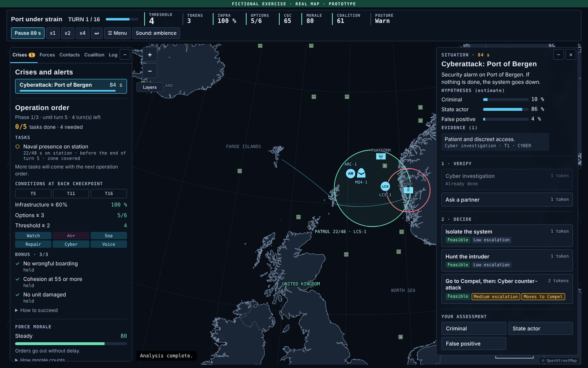 |
| Cognitive warfare: a viral video, one check done | Cyber intrusion and the escalation option |
| 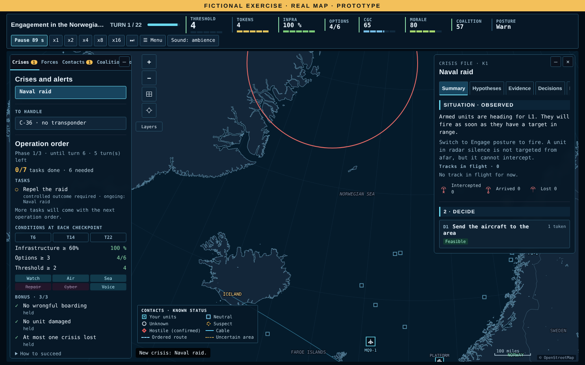 | 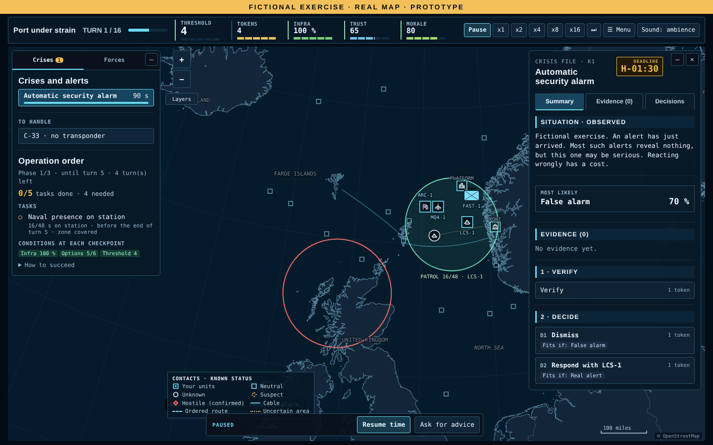 |
| Direct action: a naval raid, still unseen | A false alarm to verify, Simple level |
| 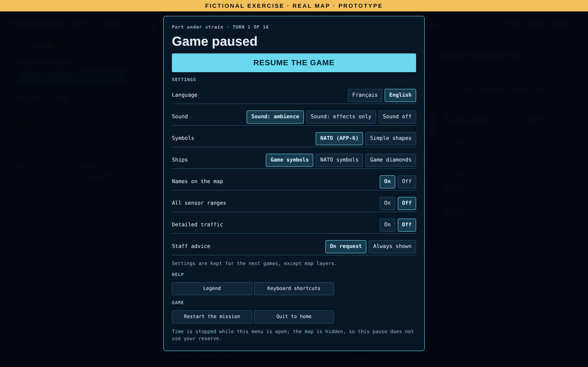 | 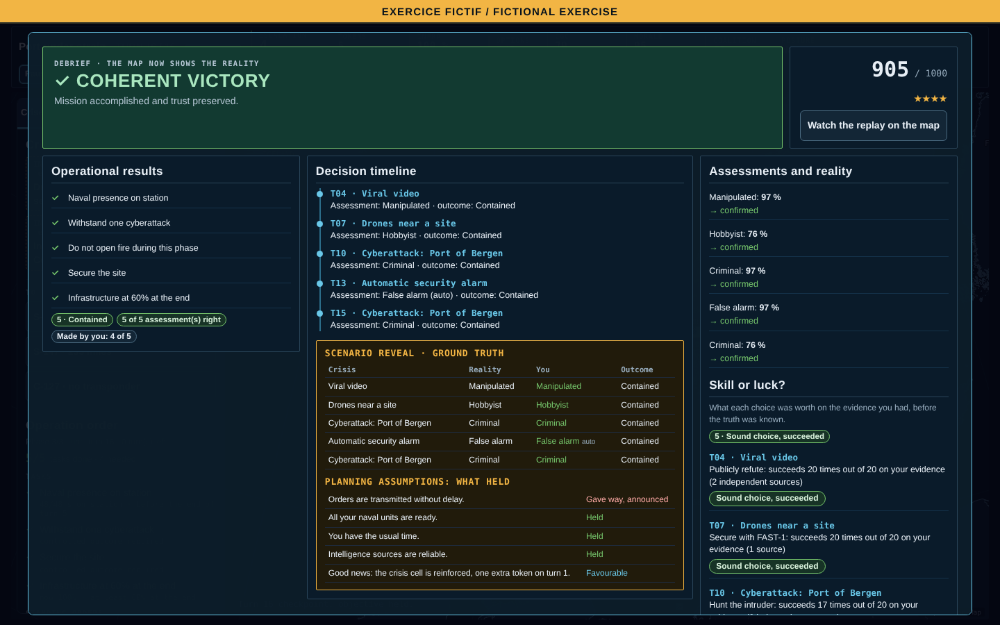 |
| In-game menu | Debrief |

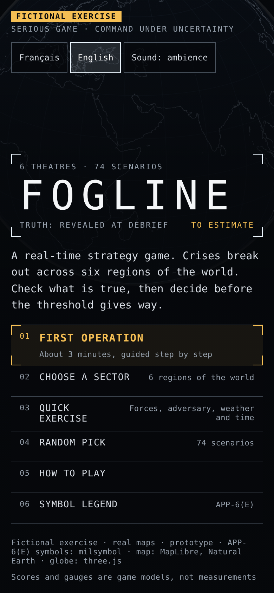 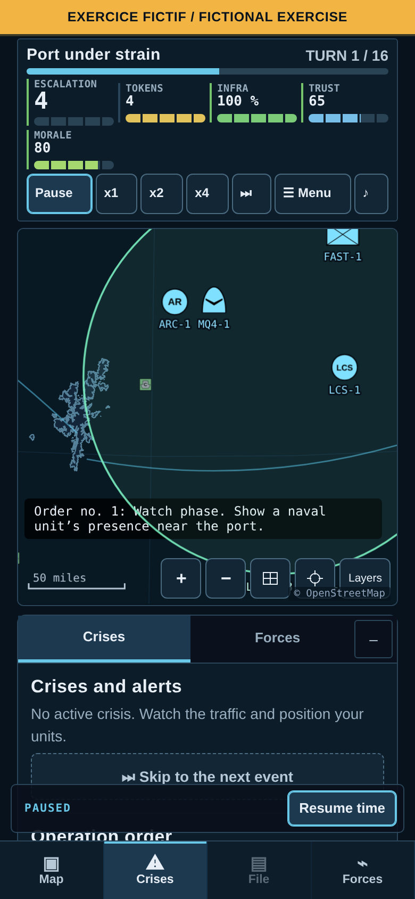

Demo videos: [cognitive and cyber warfare, French, 79 s](docs/video/seuil-demo-cognitif-cyber-fr.mp4). Older demos, recorded on a previous version: [English](docs/video/fogline-demo-en.mp4) and [French](docs/video/seuil-demo-fr.mp4). The demos are scripted and some sequences are accelerated.

## Project status

This is a prototype for testing the mechanics. Automated scripts test stability and balance, but they cannot measure fun, stress or learning. **Beta testers are wanted**, especially officers, crisis managers and strategy students. Feedback is welcome through GitHub issues or at sayhi@naullynicolas.ch.

Scores and gauges, including the cognitive centre of gravity (CGC), are game models, not scientific measurements. The game trains reasoning. It is not a decision aid and does not assess people or units.

Cyber, sabotage, jamming and disinformation are described only by their effects on decisions, never by techniques.

Symbols follow APP-6(E) through milsymbol; ships can also be shown as the game's own diamonds (menu setting). The official text of the standard was not consulted and the choices have not been validated by a specialist.

## Background

The game builds on the cognitive centre of gravity described by Naully Nicolas in « Le centre de gravité cognitif : la guerre cognitive à l'ère de l'IA, de Syracuse aux algorithmes », Revue diplomatique n° 28, Institut d'études de géopolitique appliquée (IEGA), 2026. Design inspirations include DEFCON, Jane's Fleet Command and Command: Modern Operations; no text, interface or data from these games is reused.

## How AI was used

The concept and design decisions are by Naully Nicolas. Claude (Anthropic) wrote most of the code, helped draft the scenarios and built the test scripts.

## Build

```bash
cd proto
python3 gen_db.py   # only if gen_db.py changed
python3 build.py    # writes ../index.html, seuil-prototype.html and t.html
```

Edit `proto/src.html` and `proto/gen_db.py`. Never edit `index.html` or `scenarios.json` by hand. GitHub Pages serves `index.html` from the `main` branch.

Screenshots: after building, run `node tools/shots.js $PWD en` and `node tools/shots.js $PWD fr` from the repository root.

## Tests

They need Node.js and Playwright with Chromium.

```bash
cd proto
TAG=check node stress.js 2 inv exploit labo    # stability and balance, long
node ui5.js                                    # full run with real clicks
node uimenu.js                                 # in-game menu
node uiqx.js                                   # quick exercise and fire allocation
node uiv34.js                                  # domains, land units, helicopter, formations
node uiv35.js                                  # overview, tactical view, domain orders, jamming, cyber
node uiv36.js                                  # missile tracks: icons, states, crisis file, legend
node uiv37.js                                  # turn-based, semi-real time, three.js relief, 3D view
```

`CLAUDE.md` holds the full rules, code map, test results and known defects, in French.

## Credits

- [milsymbol](https://github.com/spatialillusions/milsymbol), MIT: APP-6 symbols
- [MapLibre GL JS](https://maplibre.org/), BSD-3-Clause: vector map
- [three.js](https://threejs.org/), MIT: globe
- [Natural Earth](https://www.naturalearthdata.com/), public domain, through [world-atlas](https://github.com/topojson/world-atlas): map data
- Detailed coastlines: OpenStreetMap contributors, ODbL, through geo-maps
- IBM Plex and Saira, loaded from Google Fonts
- Sound: CC0-declared recordings from Freesound and other sources, listed in `docs/third-party/SOUND-CREDITS.md`. Some licences still need confirming before wider distribution

The project's own code is released under the MIT licence (see `LICENSE`). Third-party components, map data (Natural Earth, public domain; detailed coastlines © OpenStreetMap contributors, ODbL) and sounds have their own licences, listed in `NOTICE.md` and `docs/third-party/`; some sound licences still need confirming before wider distribution.

---

## En français

FOGLINE est un serious game de stratégie en temps réel pour apprendre à décider sous incertitude, dans la guerre hybride et la guerre cognitive. Vous commandez une petite force face à des crises fictives, sur des cartes réelles : vérifier d'abord, puis décider avant la fin du compte à rebours. La vérité n'arrive qu'au bilan.

**Exercice fictif. Prototype en développement.** Les événements, les acteurs et les valeurs de jeu sont inventés. Pas d'arme nucléaire, pas de frappe contre des villes, aucun paramètre d'arme réel.

**Jouer dans le navigateur :** https://otakuch.github.io/fogline/ (choisissez Français en haut de l'écran d'accueil)

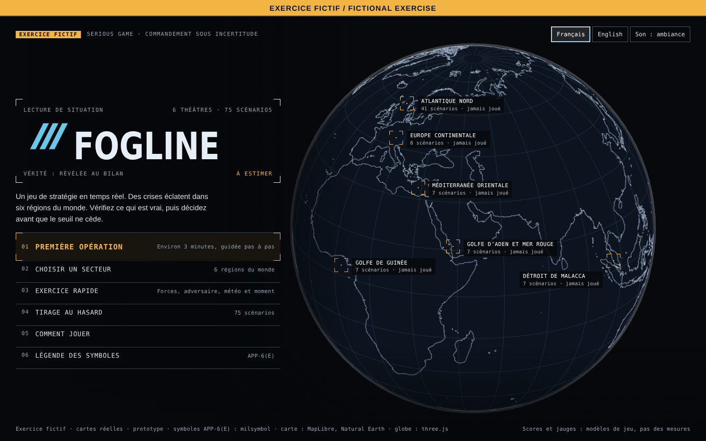

### Le jeu

- **Six théâtres :** Atlantique Nord, Europe continentale, golfe de Guinée, golfe d'Aden et mer Rouge, Méditerranée orientale, détroit de Malacca
- **75 missions et un tutoriel**, en français et en anglais : vidéo virale, intrusion cyber, câbles sous-marins menacés, navires sans AIS, brouillage, fausses alertes, et missions d'action directe avec raids navals, salves, essaims de drones et reprise de sites ou de navires capturés
- **Exercice rapide :** composez une mission en choisissant le volume des forces, le comportement et le niveau de l'adversaire, le théâtre, la situation, la météo et le moment
- **Ordre de bataille fixe :** chaque mission démarre avec des plateformes américaines sous leur vrai nom (P-8A Poseidon, MQ-4C Triton, destroyer classe Arleigh Burke, LCS classe Freedom, etc.). Toutes les valeurs sont des valeurs de jeu fictives
- **Quatre domaines :** onglets Terre, Mer, Air et Cyber pour vos forces. À terre : équipe SEAL, peloton de protection et batterie côtière défensive
- **Jeu naval inspiré de Jane's Fleet Command :** hélicoptère embarqué, contacts détectés, classés puis identifiés, formations du groupe (cercle, écran avant, ligne de file, piquet radar) et temps accéléré jusqu'à ×16
- **Vue d'ensemble et vue tactique :** une touche pour tout le théâtre, une autre pour centrer et zoomer sur l'unité, le contact ou la crise sélectionnés, avec des cercles de distance. Un ordre peut être donné à tout un domaine (terre, mer, air) en un clic
- **Guerre électronique et cyber :** brouiller un contact depuis une unité équipée, qui se dévoile alors ; aveugler ou ralentir un contact par cyberattaque. Une cyberattaque peut échouer, être repérée, puis devenir une crise publique qui demande une réponse et pèse sur la confiance publique. Décrit par les effets seulement
- **Pistes de missile :** chaque tir en vol est une piste numérotée avec son cap ; l'icône dit si elle est en vol, incertaine, interceptée, arrivée ou perdue, et le dossier de crise indique quelle défense peut l'engager
- **Trois déroulements du temps :** temps réel, semi-réel (le temps s'arrête à chaque tour et à chaque crise) ou tour par tour (vous donnez vos ordres, puis « Fin du tour » joue 30 secondes)
- **Relief et vue 3D :** une carte en relief des montagnes et des fonds marins, en option, éclairée par three.js à partir des altitudes ETOPO, et une vue 3D du théâtre avec vos unités, les contacts connus et les zones de crise
- **Collisions et inertie :** deux unités du même milieu ne se superposent plus, les navires évitent les coins de côte, et chaque unité accélère, freine et vire selon son type (un LCS est plus vif et plus rapide qu'un destroyer)
- **Règles réalistes (niveau Complet, en option) :** cibles militaires seulement, avarie qui ralentit, repli automatique, carburant de retour, radar rallumé sous attaque, bruit propre et couche thermique pour le sonar, délai de réaction. Adapté par les effets seulement, avec des valeurs fictives
- **Chasse sous-marine :** une mission d'escorte de convoi entre l'Islande et l'Écosse, où certains échos sont un sous-marin et d'autres non
- **Cartes de décision :** chaque option affiche son coût, son escalade estimée et le motif d'une indisponibilité ; une option à risque élevé demande une confirmation
- **L'attention comme ressource :** chaque vérification coûte un jeton. On ne peut pas tout vérifier
- **Maîtrise de l'escalade :** règles d'engagement, postures, seuil d'escalade et centre de gravité cognitif (CGC) en trois piliers : sécurité épistémique, cohésion sociale, résilience institutionnelle
- **Moral des forces** et cohésion de la coalition, comptés dans le score
- **Deux niveaux de commandement :** Simple (par défaut, conseil sur demande) et Complet (diplomatie, posture, estimations à la main, allocation des tirs)
- **Pas de temps mort :** quand rien ne presse, un bouton avance jusqu'au prochain événement
- **Deux horloges de décision :** 90 s en facile, 30 s en difficile
- **Menu de partie :** paramètres, légende, recommencer ou revenir à l'accueil
- **Bilan :** verdict expliqué, vérité de chaque crise à côté de votre estimation, leçons à retenir, pertes et rejeu sur la carte

### Captures

| | |
|---|---|
| 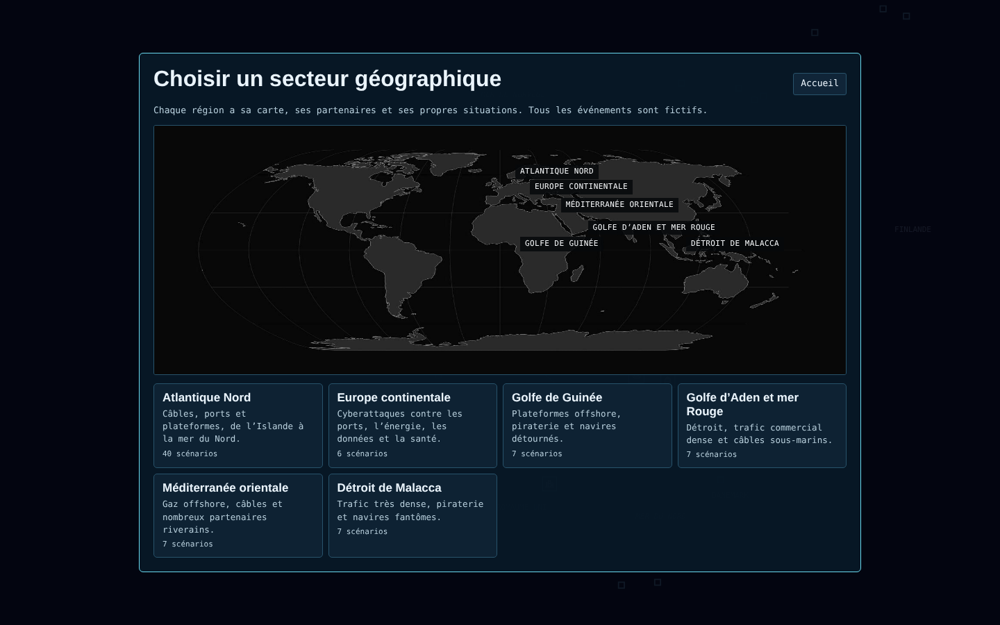 | 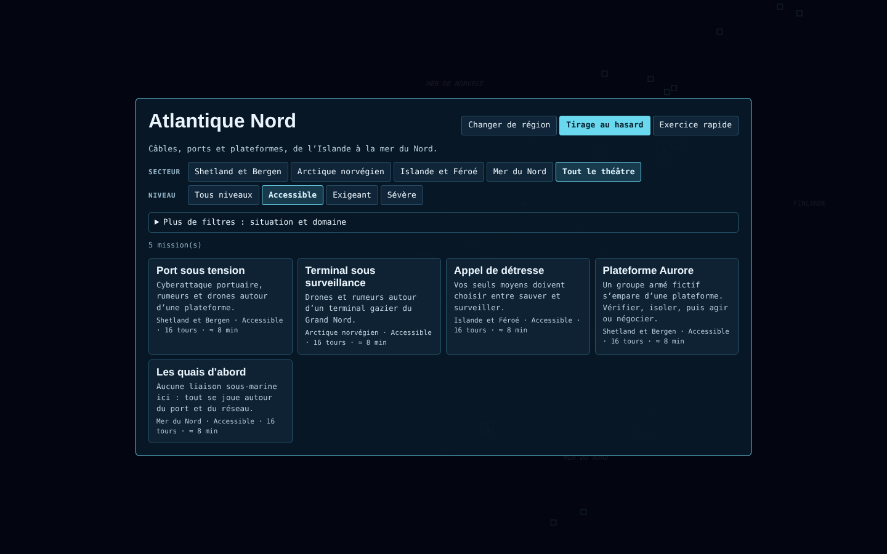 |
| Choix du théâtre | Catalogue des missions |
| 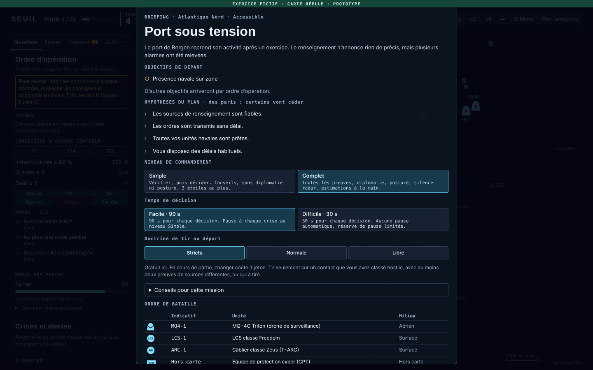 | 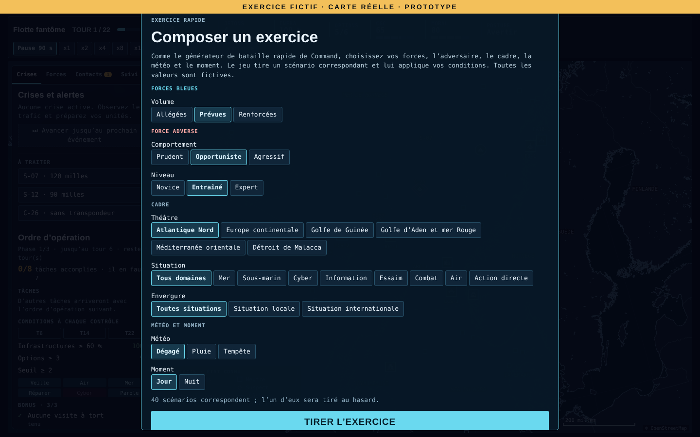 |
| Briefing et ordre de bataille | Exercice rapide |
| 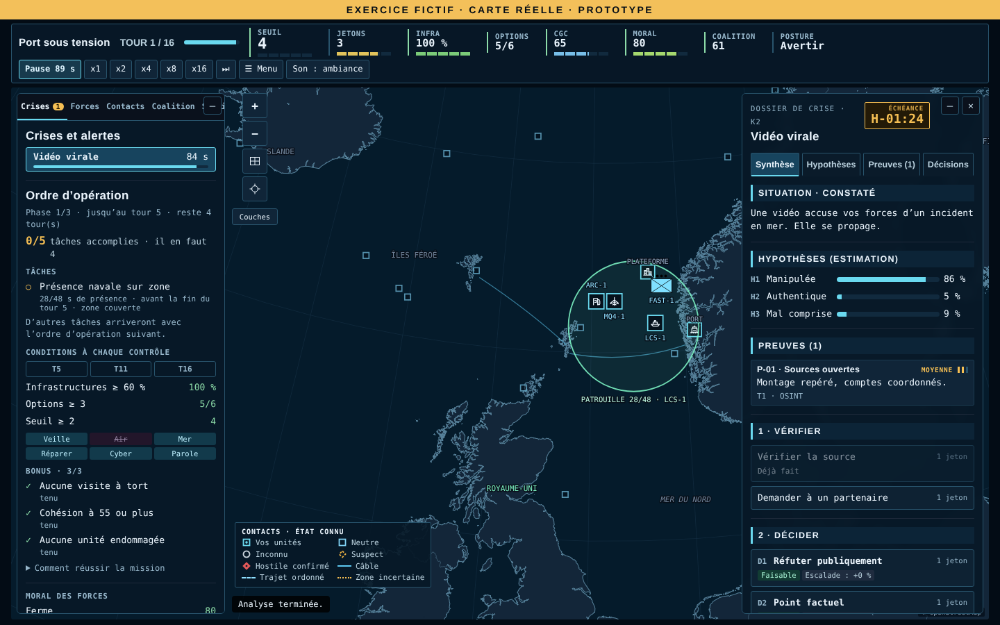 | 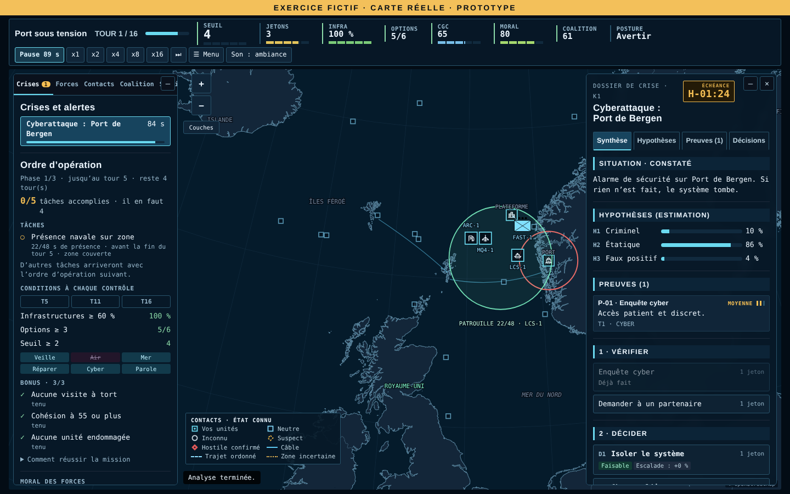 |
| Guerre cognitive : une vidéo virale, une vérification faite | Intrusion cyber et option d'escalade |
| 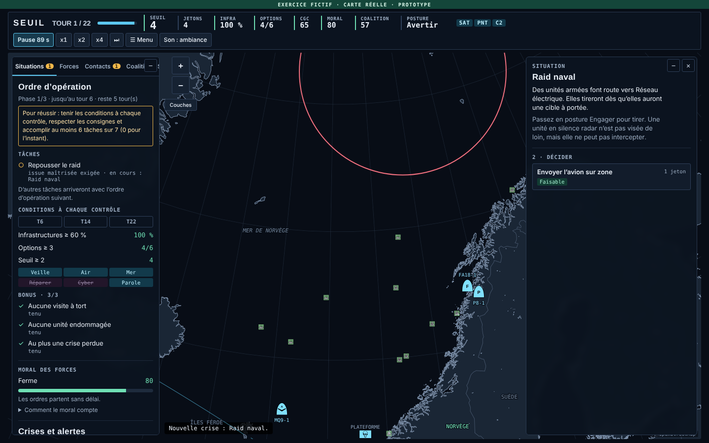 | 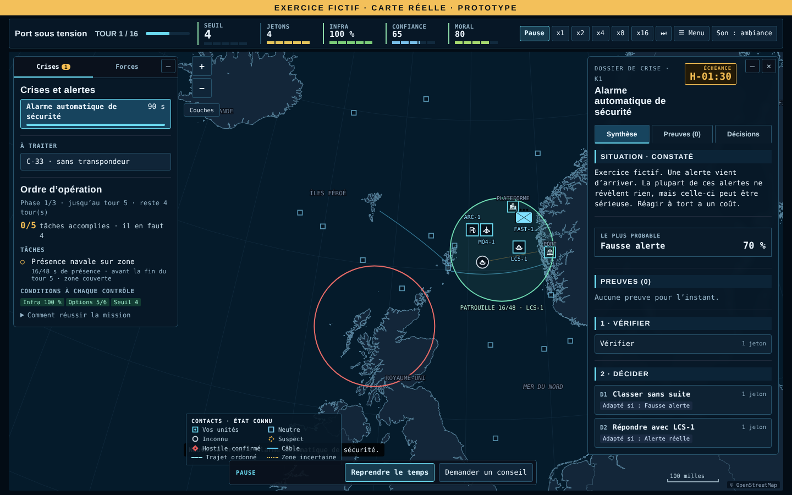 |
| Action directe : un raid naval encore invisible | Une fausse alerte à vérifier, niveau Simple |
| 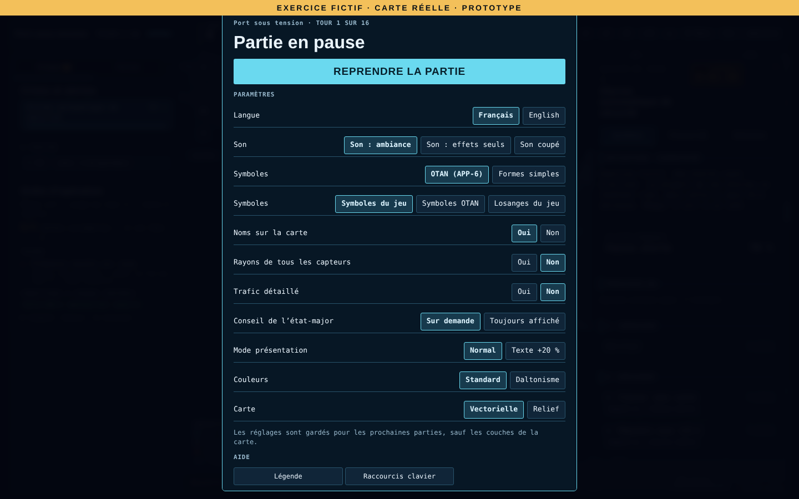 | 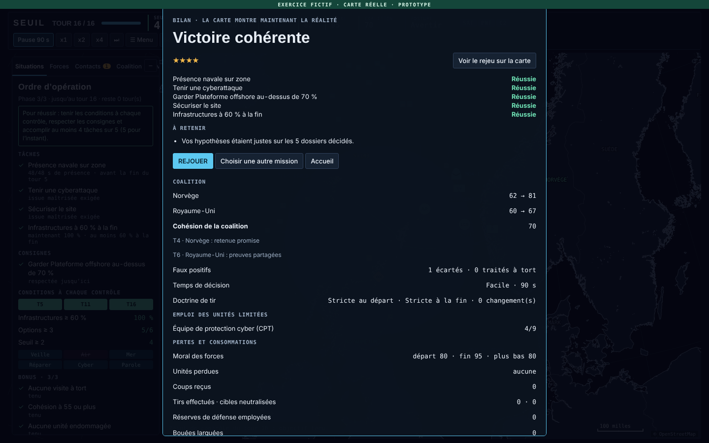 |
| Menu de partie | Bilan |

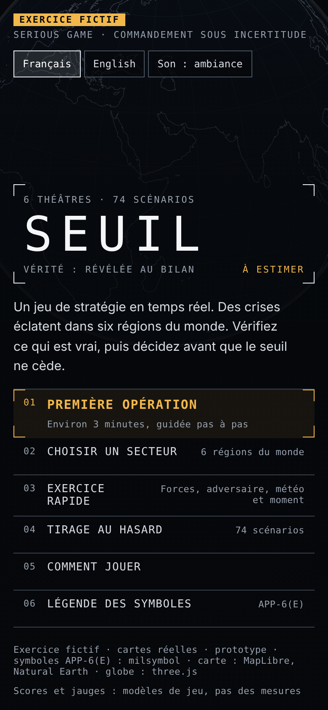 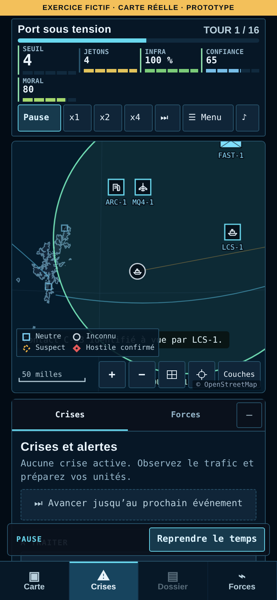

[Vidéo de démonstration : guerre cognitive et guerre cyber, 79 s](docs/video/seuil-demo-cognitif-cyber-fr.mp4). La séquence est scriptée et la fin de partie est accélérée.

### État du projet

Ce prototype sert à tester les mécaniques. Les scripts automatiques vérifient la stabilité et l'équilibre, mais ils ne mesurent ni le plaisir de jeu, ni le stress, ni l'apprentissage. **Le projet cherche des bêta-testeurs**, en particulier des officiers, des cadres de gestion de crise et des étudiants en stratégie. Vos retours sont les bienvenus dans les issues GitHub ou à sayhi@naullynicolas.ch.

Les scores et les jauges, dont le centre de gravité cognitif, sont des modèles de jeu, pas des mesures scientifiques. Le jeu entraîne un raisonnement ; ce n'est pas une aide à la décision et il n'évalue ni des personnes ni des unités. Le cyber, le sabotage, le brouillage et la désinformation sont décrits par leurs effets sur la décision, jamais par des techniques.

Le jeu s'appuie sur l'article de Naully Nicolas « Le centre de gravité cognitif : la guerre cognitive à l'ère de l'IA, de Syracuse aux algorithmes », Revue diplomatique n° 28, IEGA, 2026.

Le code du projet est sous licence MIT (fichier `LICENSE`). Les composants tiers, les données de carte et les sons ont leurs propres licences, listées dans `NOTICE.md` et `docs/third-party/`.
