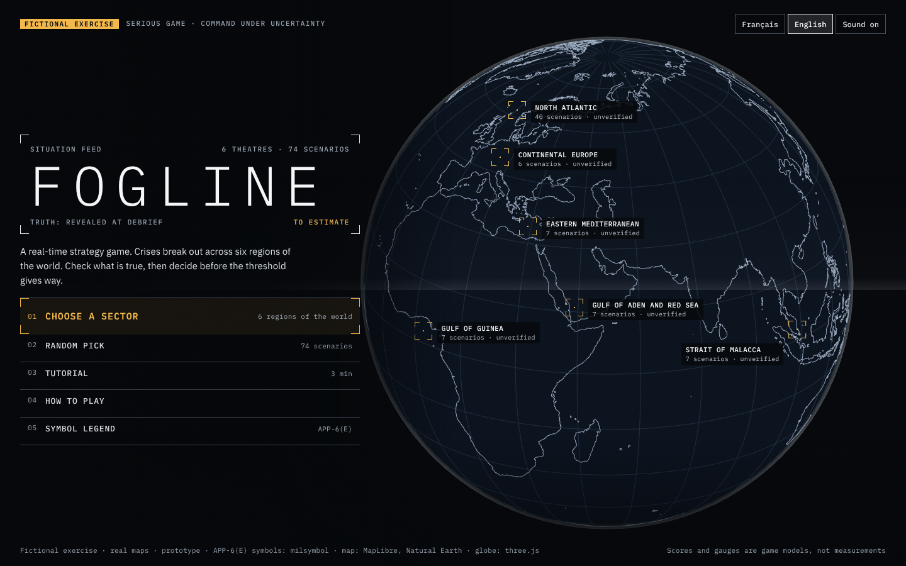
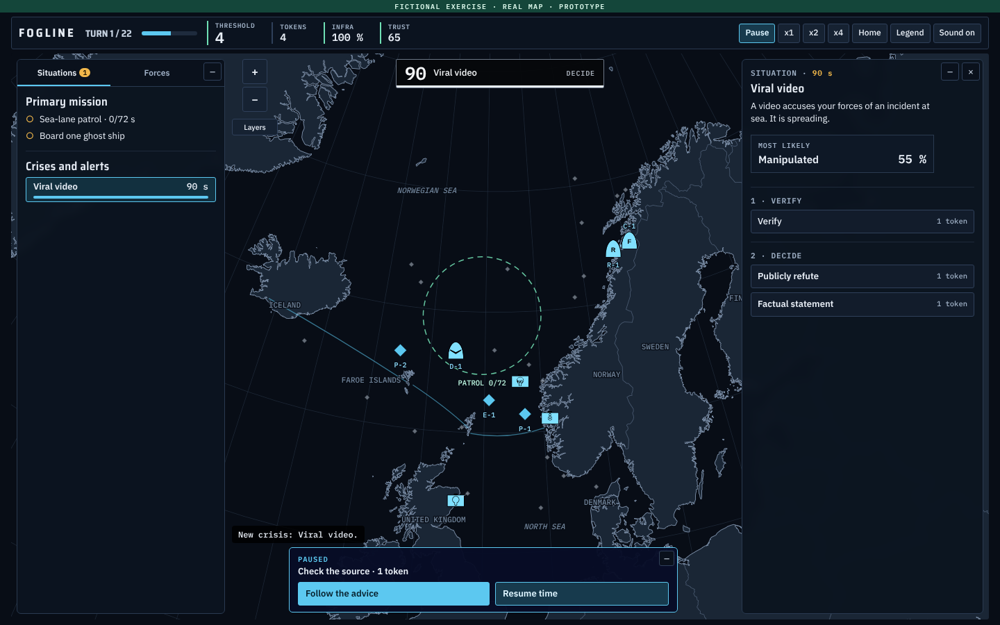
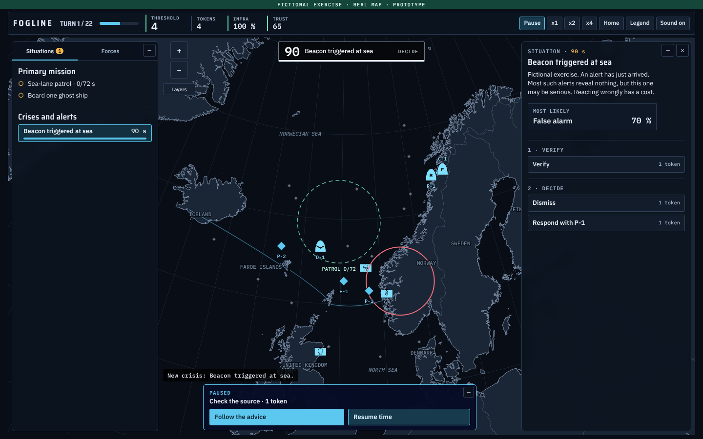
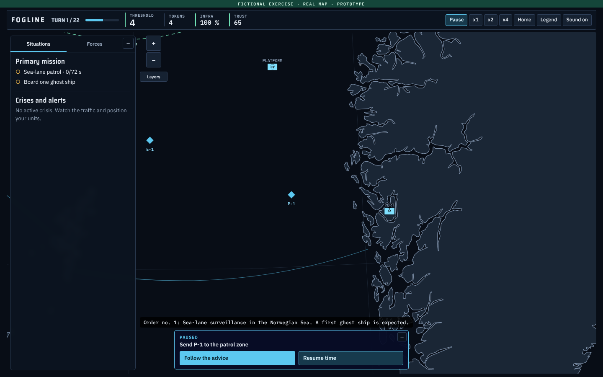
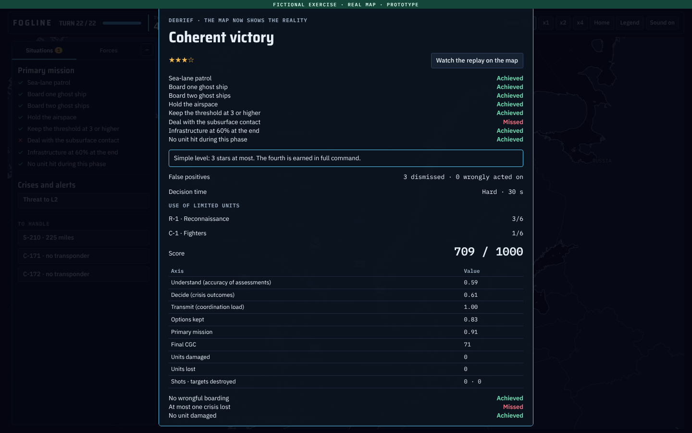
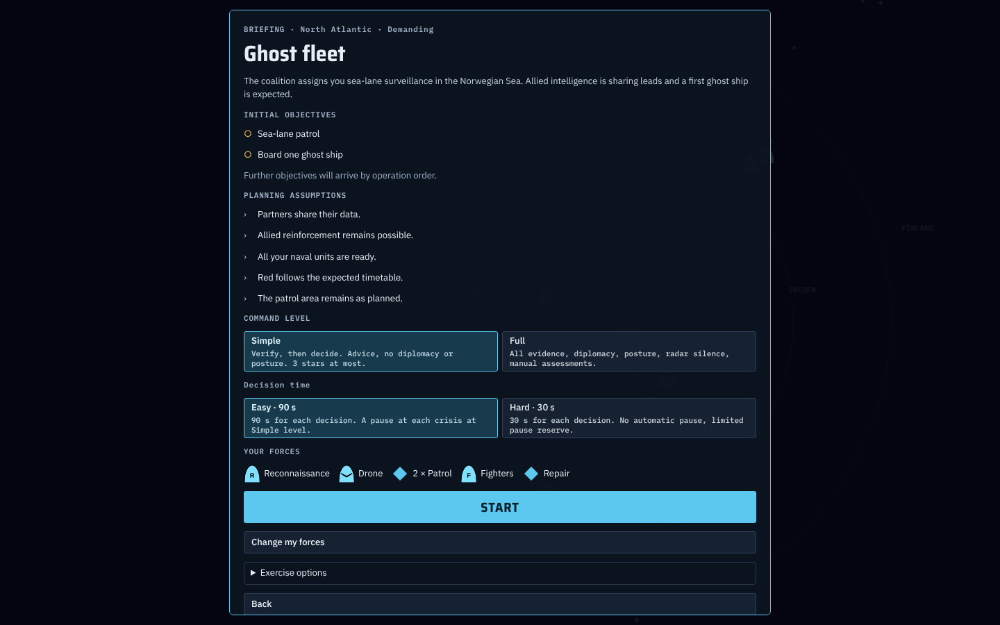
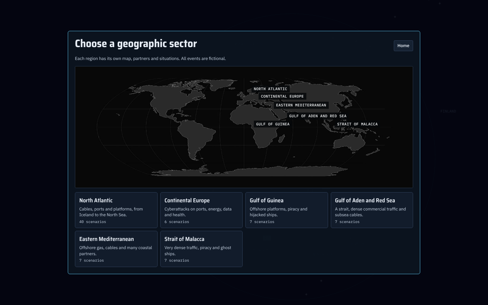
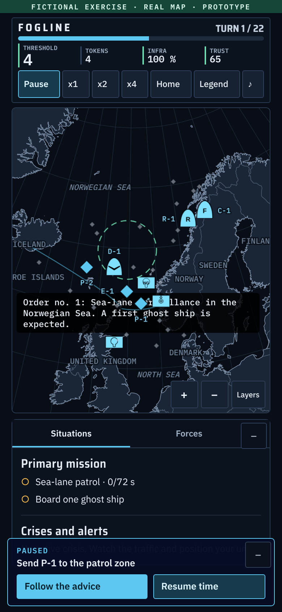
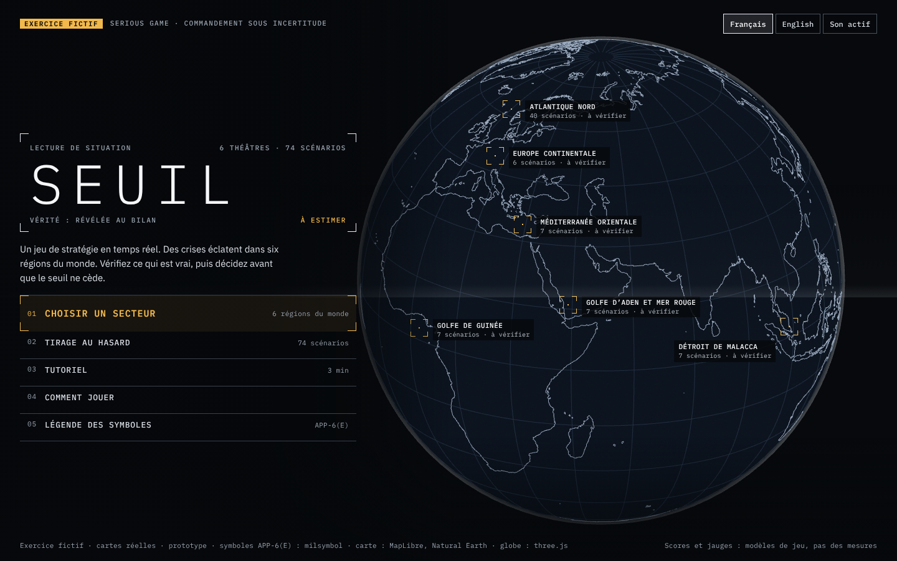

# FOGLINE (SEUIL in French)

A real-time strategy serious game for learning to decide under uncertainty. You command a small force through fictional crises on real maps: verify first, then decide before the countdown ends.

**Fictional exercise. Prototype.** Events, actors and game values are invented. There are no nuclear weapons and no strikes on cities.



## Play

Open `index.html` in a recent browser. No install or server is needed. Internet access only loads the web fonts.

To publish it, enable GitHub Pages on the `main` branch, root folder.

Demo videos: [English](docs/video/fogline-demo-en.mp4) and [French](docs/video/seuil-demo-fr.mp4). The demo is scripted and some sequences are accelerated.

## The game

- **Six theatres:** North Atlantic, continental Europe, Gulf of Guinea, Gulf of Aden and Red Sea, Eastern Mediterranean, Strait of Malacca
- **74 missions and a tutorial**, in English and French, including missions with no subsea cables
- **8 to 11 minutes** per mission at normal speed
- **Two decision clocks:** 90 s on Easy, 30 s on Hard
- **Two command levels:** Simple (default) and Full, which adds diplomacy, posture and manual assessments
- **False positives:** many alerts reveal nothing, and reacting wrongly has a cost
- **Varying objectives** drawn for each game
- **Debrief:** reveals the truth, your errors of judgement and a replay on the map

| | |
|---|---|
|  |  |
| A crisis and its countdown | An alert to verify |
|  |  |
| Vector map at high zoom | Debrief |
|  |  |
| Briefing | Choice of theatre |



## Project status

This is a prototype for testing the mechanics. Automated scripts test stability and balance, but they cannot measure fun, stress or learning. **Beta testers are wanted**, especially for gameplay feedback.

Scores and gauges, including the cognitive centre of gravity (CGC), are game models, not scientific measurements. The game trains reasoning. It is not a decision aid and does not assess people or units.

Ships use diamonds specific to this game. Other symbols follow APP-6(E) through milsymbol, but the official text was not consulted and the choices have not been validated by a specialist.

## How AI was used

The concept and design decisions are by Naully Nicolas. Claude (Anthropic) wrote most of the code, helped draft the scenarios and built the test scripts.

## Build

```bash
cd proto
python3 gen_db.py   # only if gen_db.py changed
python3 build.py    # writes ../index.html, seuil-prototype.html and t.html
```

Edit `proto/src.html` and `proto/gen_db.py`. Never edit `index.html` or `scenarios.json` by hand.

## Tests

They need Node.js and Playwright with Chromium.

```bash
cd proto
TAG=check node stress.js 2 inv exploit labo    # stability and balance, long
node ui5.js                                    # full run with real clicks
node uim.js                                    # phone-width screens
```

`CLAUDE.md` holds the full rules, code map and known defects, in French.

## Credits

- [milsymbol](https://github.com/spatialillusions/milsymbol), MIT: APP-6 symbols
- [MapLibre GL JS](https://maplibre.org/), BSD-3-Clause: vector map
- [three.js](https://threejs.org/), MIT: globe
- [Natural Earth](https://www.naturalearthdata.com/), public domain, through [world-atlas](https://github.com/topojson/world-atlas): map data
- IBM Plex and Saira, loaded from Google Fonts

Licences are in `docs/third-party/`. The licence for this project's own code and content has not been chosen yet, so all rights are reserved until one is added.

---

## En français

SEUIL est un serious game de stratégie en temps réel pour apprendre à décider sous incertitude. Tous les événements sont fictifs, sur des cartes réelles.



Ouvrez `index.html` pour jouer, puis choisissez Français en haut de l'écran. [Vidéo de démonstration en français](docs/video/seuil-demo-fr.mp4).

Le projet cherche des bêta-testeurs, surtout pour le gameplay. Les scores et les jauges sont des modèles de jeu, pas des mesures scientifiques.
